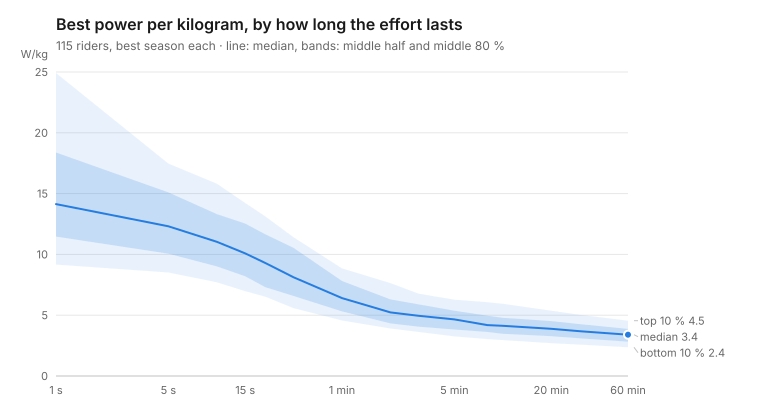

# wattlake

[](https://github.com/zieludev/wattlake/actions/workflows/ci.yml)

Power analytics for thousands of cyclists, in PySpark. It reads the
[GoldenCheetah OpenData](https://github.com/GoldenCheetah/OpenData) set, where 6,613 athletes
shared every ride they recorded, second by second, and turns the raw files into what a rider
looks at: the best power for every effort length, critical power and W', fitness and fatigue
day by day, and where one rider stands among the others.

The first 150 athletes of the set (2.5 GB of zips, 305 million samples, 56,798 hours of cycling)
go through the whole pipeline in about five minutes on a laptop. What they show is in
[docs/results.md](docs/results.md):

<picture>
  <source media="(prefers-color-scheme: dark)" srcset="docs/img/power-profile-dark.svg">
  
</picture>

- The median rider's best 20 minutes come to 3.9 W/kg, the top tenth's to 5.4 W/kg.
- 303 of 310 rider seasons give a critical power fit with R² of at least 0.95; the median CP is
  256 W, or 3.55 W/kg, and the median W' 17.8 kJ.
- The best power computed here agrees with what GoldenCheetah computed itself, ride by ride,
  within 1 % for 97 to 99 % of the rides at every duration.

## Try it

You need [uv](https://docs.astral.sh/uv/) and Java 17 or 21, or Docker and nothing else (see
[On a cluster](#on-a-cluster)).

```bash
git clone https://github.com/zieludev/wattlake.git
cd wattlake
uv run wattlake fetch --athletes 150 --max-mb 150   # 2.5 GB from OSF, each zip checked against its SHA-256
uv run wattlake build                               # data/raw -> bronze -> silver -> gold
uv run wattlake report                              # docs/results.md and its charts
```

`fetch` takes the first athletes by id that fit under `--max-mb`. The ids are random UUIDs, so
that is a random sample, and the same one on every machine. These are the commands that made
the results in `docs/`. `wattlake --help` lists the rest, and `wattlake build silver gold` runs
only some of the stages.

## What it computes

| table | one row per | what |
| --- | --- | --- |
| `gold/rides` | ride | length, average power, Normalized Power, work, FTP estimate, IF, TSS |
| `gold/ride_mmp` | ride and duration | best power for 15 durations from 1 s to 60 min, in W and W/kg |
| `gold/seasons` | rider and year | best power of the year, critical power and W' fitted to it |
| `gold/training_load` | rider and day | TSS, fitness (CTL), fatigue (ATL) and form (TSB) |
| `gold/population` | gender and duration | percentiles of the riders' best power per kilogram |

[docs/pipeline.md](docs/pipeline.md) goes through the stages: how the zips are unpacked on the
executors, how files named in local time are matched to rides stamped in UTC, how the power of a
ride gets onto a 1 s grid with one shuffle, and how critical power is fitted with Spark's
regression aggregates.

[docs/data.md](docs/data.md) is about the data set: what it holds, and what it took to read it.
Recording intervals of 1.26 s, an empty sport on rides that are runs, years of birth in the
2080s and a file called `2015_01_20_18_50_00.csv.bak.csv` among them.

[docs/benchmark.md](docs/benchmark.md) compares three ways to compute the best power of every
ride. A sliding window frame is about 150 times slower than a running sum, and numpy through
`applyInPandas` beats the running sum in Spark's own window functions by about 1.35 times.

## On a cluster

`compose.yaml` runs a Spark master, two workers and the pipeline, all from one image with Java
21 and the same Python, which a cluster that runs Python functions needs on every node:

```bash
export UID; export GID=$(id -g)       # so the files in ./data are yours; 1000:1000 if unset
docker compose build
docker compose up -d master worker-1 worker-2
docker compose run --rm pipeline wattlake fetch --athletes 150 --max-mb 150
docker compose run --rm --service-ports pipeline wattlake build --master spark://master:7077
docker compose run --rm pipeline wattlake report --out data/results
docker compose down
```

The master's web UI is on http://localhost:8080, and the one of a running build on
http://localhost:4040. Every container mounts `./data` at the same path, because the executors
open the zips and write the tables there themselves.

## What is verified

| What | Status |
| --- | --- |
| Each stage on made-up athletes: time zones, a change to summer time, two rides a file could belong to, 1.26 s recording, gaps, spikes, which rides are cycling | run |
| The three MMP methods against each other, and NP and MMP against a plain numpy reading of their definitions | run |
| CP and W' recovered from bests that follow the model; FTP using only the 90 days before a ride; CTL and ATL against their closed form | run |
| One real athlete from the set (in `tests/data`): every file finds its ride, and the best power of every ride is within 1 % or 1 W of GoldenCheetah's | run |
| 146 athletes against GoldenCheetah's own numbers, ride by ride | run, see [docs/results.md](docs/results.md) |
| `.github/workflows/ci.yml` on GitHub: lint, types, the tests on Python 3.11 to 3.14, the Docker image | run on GitHub |
| The Compose cluster: a master, two workers and a build on 16 athletes | run on one machine |
| The whole set, 6,613 athletes and 115.6 GB | not run |
| A cluster of more than one machine, or data on S3 or HDFS | not run |

## Development

```bash
uv sync                      # Python 3.11 or newer, fetched by uv if needed
uv run pytest                # needs Java 17 or 21; about a minute
uv run ruff check && uv run ruff format --check
uv run basedpyright
```

Without Java on the machine, the tests run in the image:

```bash
docker build --target dev -t wattlake:dev .
docker run --rm -v "$PWD":/app --user "$(id -u):$(id -g)" wattlake:dev pytest -p no:cacheprovider
```

## Licence

[MIT](LICENSE). What this builds on is listed in [3rdparty_licenses.md](3rdparty_licenses.md),
with a note on the jars that come with pyspark.

The data is the [GoldenCheetah OpenData](https://github.com/GoldenCheetah/OpenData) set,
published under [CC0 1.0](https://creativecommons.org/publicdomain/zero/1.0/) on
[osf.io/6hfpz](https://osf.io/6hfpz/) thanks to the GoldenCheetah project and the athletes who
shared their rides. None of it is in this repository apart from one athlete in `tests/data`.
No code of the GoldenCheetah application (GPL) is used: the formulas here are written from
their published definitions, and GoldenCheetah's stored numbers are only compared against.

Normalized Power, NP, Training Stress Score, TSS, Intensity Factor and IF are registered
trademarks of TrainingPeaks. This project is not affiliated with TrainingPeaks or with
GoldenCheetah.
