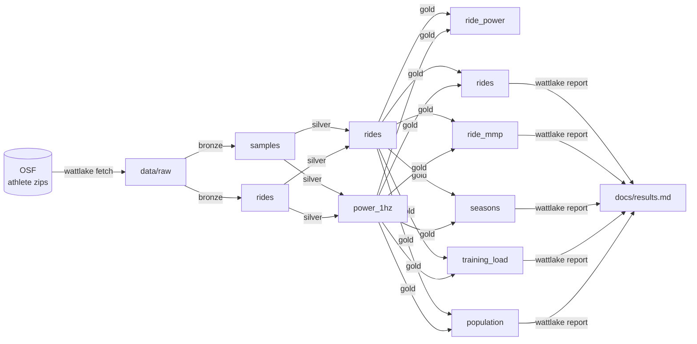

# How it works

Every table is Parquet (zstd) under `data/<layer>/<table>`, and every stage reads the stage
before it from disk, so `wattlake build silver gold` starts again from bronze without unpacking
the zips again. A stage rewrites its tables whole.

| layer | table | one row per | what |
| --- | --- | --- | --- |
| bronze | `samples` | recorded sample | the CSVs as they are, with the athlete and the file name |
| bronze | `rides` | ride in an athlete's JSON | start time in UTC, sport, channels, GoldenCheetah's metrics as JSON text |
| silver | `rides` | activity file with a ride | the two matched, the time zone offset, cycling or not, weight, GoldenCheetah's MMP and NP |
| silver | `power_1hz` | second of a cycling ride | power on a 1 s grid |
| gold | `ride_power` | cycling ride | length, average power, work, NP, best power for 15 durations from 1 s to 60 min |
| gold | `rides` | ride that passes the plausibility check | the above with date, FTP estimate, IF and TSS |
| gold | `ride_mmp` | ride and duration | best power in watts and watts per kilogram |
| gold | `seasons` | rider, year and duration | best power of the year, and the year's critical power and W' |
| gold | `training_load` | rider and day | TSS, CTL, ATL, TSB |
| gold | `population` | gender (and everyone) and duration | percentiles of the riders' best power per kilogram |

## Bronze

A zip is opened by a Python task on an executor. Spark's `binaryFile` source lists the zips, and
because the `content` column is never selected it opens none of them: the DataFrame holds paths
only. It is hashed into as many partitions as there are zips, which spreads the zips over the
tasks, and `mapInArrow` hands each partition to a function that unpacks the zip with `zipfile`, reads each CSV with pyarrow's CSV
reader, and yields Arrow record batches that Spark writes without converting a row at a time.

Readings are stored as float32 (a reading has at most 6 significant digits) and the time as
float64. With zstd, bronze takes 2.3 GB for 2.5 GB of zips.

Opening the zips by path means every executor has to see the same files at the same path: the
local disk in local mode, the `./data` mount in the Compose cluster. On S3 or HDFS, reading the
`content` column instead would work, at the cost of holding a whole zip, up to 264 MB, in one
row.

## Silver

**Files to rides.** A file named in local time and a ride stamped in UTC belong together when
they are a whole number of quarter hours apart, at most 14 hours. Comparing every file with every
ride of its athlete would be quadratic in the size of the athlete's history, so the join key is
the athlete plus a calendar day: each ride is copied to the day before and the day after, and a
file meets only the rides of three days. Among the candidates, the athlete's usual offset (the
most common one among files with only one candidate) decides; then each ride keeps its closest
file. [data.md](data.md) has what this finds.

**The 1 Hz grid.** Readings above 2,500 W are dropped, the readings of each second are reduced
to the last one, and each remaining reading then covers the seconds up to the next one: a
`lead` finds the next reading, and `explode(sequence(t, next - 1))` writes a row for every second
in between, at the reading's power for up to 5 seconds and at 0 W after that. No grid of every
second is built and joined.

All of it happens per activity, so one `repartition` by athlete and activity is the only shuffle:
the aggregation and both windows after it keep that partitioning. The physical plan of
`power_1hz` has a single `Exchange`, plus the broadcast that keeps only the cycling rides.

## Gold

**Ride power.** Each ride's seconds go to numpy through `applyInPandas`. One running sum gives
the average of every d consecutive seconds as the difference of two of its entries, so the best
average for 15 durations, the Normalized Power (the fourth root of the mean fourth power of the
30 s averages), the average power and the work all come from one pass.
[benchmark.md](benchmark.md) has why this is numpy and not Spark's window functions.

**Plausibility.** A ride whose best power per kilogram is above what any rider has done, for 1 s,
5 s, 1, 5, 20 or 60 minutes, leaves the gold tables.

**FTP, IF and TSS.** TSS needs the rider's FTP on the day of the ride. With no FTP test in the
data, it is 95 % of the rider's best 20 minutes in the 90 days before the ride: a window over
the day number with `rangeBetween(-90, -1)`, so a ride never sees itself or anything after it.
IF is NP / FTP and TSS is hours × IF² × 100. A ride without an earlier 20 minute best has no
TSS, and an IF over 1.3 says the estimate is too low, so that ride has none either.

**Critical power.** For each rider and year with at least ten rides, the best power at 3, 5, 8,
10 and 20 minutes goes into the linear work-time model: the work of a best effort is
W' + CP × t. Spark's `regr_slope`, `regr_intercept` and `regr_r2` fit it as an aggregate, with
the work as y and the duration as x, so CP is the slope and W' the intercept. A fit counts when
all five points exist, R² is at least 0.95, CP is between 80 and 550 W and W' between 2 and
50 kJ.

**Training load.** CTL and ATL are exponentially weighted averages of the daily TSS with time
constants of 42 and 7 days: each day's value is the day before's plus 1/42 (or 1/7) of the
difference to today's TSS. A day depends on the day before, which no window function expresses,
so each rider's days go to pandas whole (`applyInPandas`), get the days without a ride filled
in with 0 and run through the recursion. TSB is CTL - ATL.

**Population.** Each rider's best power per kilogram for each duration, taken over their seasons
of ten rides or more, goes into `percentile_approx` by gender and for everyone.

## On a cluster

`compose.yaml` runs a standalone Spark master, two workers and the pipeline as the driver, all
from the same image. They have to be: a Python function that Spark ships to an executor is
pickled on the driver and run by the executor's Python, so the Python version and the packages
on every node must match.

The containers run with the host user's UID so that the files in `./data` belong to that user.
Spark's Hadoop code looks the user's name up and fails when the UID has none in the image;
`docker/entrypoint.sh` gives it one with nss_wrapper rather than make `/etc/passwd` writable.

## Not done

- The whole set, 6,613 athletes and 115.6 GB, has not been through the pipeline.
- A build rewrites every table; there are no incremental loads.
- Rides are dated by their local start; a ride across midnight counts for the day it started.
