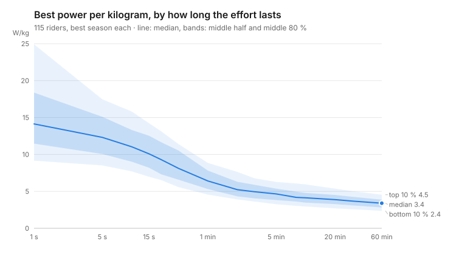
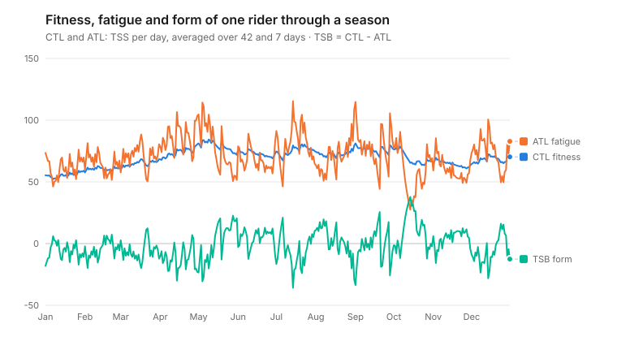

# Results

What `wattlake build` and `wattlake report` found in 146 athletes of the GoldenCheetah OpenData set, counting those with at least one ride. `wattlake fetch` takes the first athletes by id, a random sample because the ids are random UUIDs; the [README](../README.md#try-it) has the command that fetched these. Spark 4.3.0, written 2026-11-26.

## The data

|  | count |
| --- | --- |
| rides the athletes' JSON describes | 59,786 |
| activity files with samples | 57,807 |
| files matched to a ride | 57,729 (99.9%) |
| cycling rides with power | 29,328 |
| of them in the gold tables | 29,252 |
| hours of riding at 1 Hz | 56,798 |

A ride leaves the gold tables when it lasts under a minute or over a day, or when its power per kilogram beats what any rider has done: a power meter gone wrong or a wrong weight.

## Agreement with GoldenCheetah

GoldenCheetah stored its own mean-maximal power with every ride, computed by its own code from the same file. The two are compared ride by ride, so this checks the whole path from zip to gold table: the matching of files to rides, the 1 Hz grid and the running sums.

| duration | rides | median difference | within 1 % | within 5 % |
| --- | --- | --- | --- | --- |
| 1 s | 29,232 | 0.00% | 99.0% | 99.6% |
| 5 s | 29,228 | 0.05% | 97.6% | 99.5% |
| 1 min | 29,225 | 0.09% | 98.6% | 99.7% |
| 5 min | 29,050 | 0.11% | 99.0% | 99.7% |
| 20 min | 27,773 | 0.12% | 98.8% | 99.6% |
| 60 min | 19,862 | 0.14% | 97.1% | 98.3% |

## Power profile

<picture>
  <source media="(prefers-color-scheme: dark)" srcset="img/power-profile-dark.svg">
  
</picture>

Best power per kilogram of body weight, each rider counted once with their best season. A season counts when it has at least ten rides with power. Left out, with fewer than 10 riders: women.

| riders | duration | n | 10th | 25th | median | 75th | 90th |
| --- | --- | --- | --- | --- | --- | --- | --- |
| all | 5 s | 115 | 8.51 | 10.06 | 12.31 | 15.09 | 17.47 |
| all | 1 min | 115 | 4.57 | 5.31 | 6.41 | 7.81 | 8.85 |
| all | 5 min | 115 | 3.25 | 3.82 | 4.65 | 5.37 | 6.27 |
| all | 20 min | 115 | 2.69 | 3.27 | 3.88 | 4.52 | 5.37 |
| all | 60 min | 114 | 2.36 | 2.82 | 3.40 | 3.88 | 4.55 |
| men | 5 s | 113 | 8.67 | 10.18 | 12.31 | 14.92 | 17.46 |
| men | 1 min | 113 | 4.57 | 5.32 | 6.41 | 7.81 | 8.85 |
| men | 5 min | 113 | 3.37 | 3.85 | 4.65 | 5.37 | 6.27 |
| men | 20 min | 113 | 2.77 | 3.30 | 3.88 | 4.52 | 5.37 |
| men | 60 min | 112 | 2.44 | 2.82 | 3.40 | 3.88 | 4.55 |

## Critical power

303 of 310 rider seasons have a fit that holds up: the best efforts of 3, 5, 8, 10 and 20 minutes all exist, the line through their work fits with R² of at least 0.95, and CP and W' are in a human range.

|  | 25th | median | 75th |
| --- | --- | --- | --- |
| CP, W | 225 | 256 | 294 |
| CP, W/kg | 3.02 | 3.55 | 4.19 |
| W', kJ | 12.3 | 17.8 | 23.7 |
| R² of the fit | 0.998 | 0.999 | 1.000 |

## Training load

<picture>
  <source media="(prefers-color-scheme: dark)" srcset="img/training-load-dark.svg">
  
</picture>

The rider with the most days of riding in one year: 297 days in 2019. TSS needs an FTP; each ride takes 95 % of the rider's best 20 minutes in the 90 days before it.

| first of | CTL | ATL | TSB |
| --- | --- | --- | --- |
| Jan | 55 | 73 | -18 |
| Feb | 58 | 60 | -2 |
| Mar | 60 | 58 | 3 |
| Apr | 68 | 79 | -10 |
| May | 81 | 105 | -23 |
| Jun | 76 | 79 | -3 |
| Jul | 75 | 91 | -17 |
| Aug | 74 | 64 | 11 |
| Sep | 81 | 115 | -34 |
| Oct | 76 | 78 | -1 |
| Nov | 65 | 59 | 6 |
| Dec | 64 | 73 | -9 |
